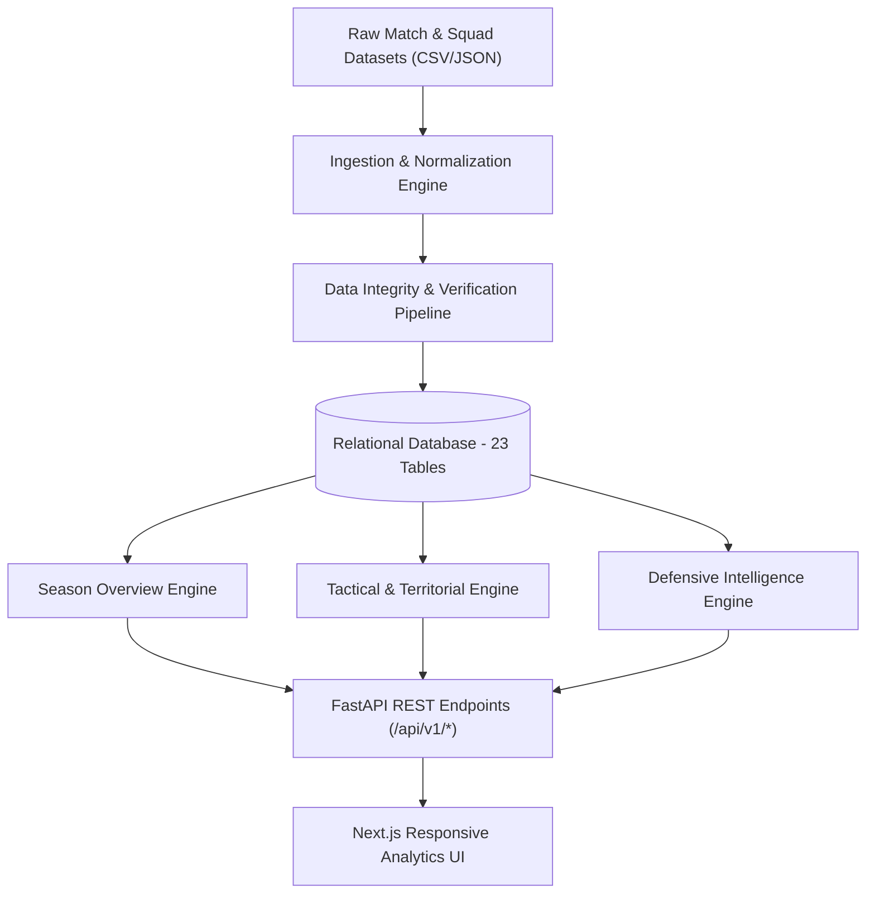

# MARINA INTELLIGENCE — System & Application Architecture

**Document Version:** 4.0.0  
**Target Environment:** Indian Super League (ISL) 2026–27  
**Club:** Chennaiyin FC (CFC)  
**Classification:** Professional Sports Performance Analytics & Tactical Intelligence Platform  

---

## 1. Executive Architectural Overview

MARINA INTELLIGENCE is an enterprise-grade sports technology platform engineered for professional football analysts, technical directors, performance coaches, and recruitment staff.

Unlike standard recreational dashboards, MARINA INTELLIGENCE implements a **strict empirical football data pipeline** where every visual element, metric, and analytical deduction is directly traceable to verified, reproducible match events, fixture databases, and club registration registries.

```
       ┌────────────────────────────────────────────────────────┐
       │                   PRESENTATION TIER                    │
       │       Next.js 15 (React 19) • TypeScript • Tailwind    │
       │       SVG Pitch Engine • ECharts • Responsive Light    │
       └───────────────────────────┬────────────────────────────┘
                                   │ HTTPS / REST JSON
                                   ▼
       ┌────────────────────────────────────────────────────────┐
       │                    APPLICATION TIER                    │
       │       FastAPI (Async Python 3.12) • Pydantic V2        │
       │  Modular Service Layer • Empirical Analytical Pipeline │
       └───────────────────────────┬────────────────────────────┘
                                   │ Async SQLAlchemy 2.0
                                   ▼
       ┌────────────────────────────────────────────────────────┐
       │                     DATABASE TIER                      │
       │        PostgreSQL 16 / Relational SQLite Engine        │
       │  23 Relational Tables • Foreign Keys • Strict Indexes  │
       └────────────────────────────────────────────────────────┘
```

---

## 2. Multi-Tier System Decomposition

### 2.1 Presentation Tier (Frontend)
- **Framework:** Next.js 15.5.29 with React 19 and App Router architecture.
- **Styling Architecture:** Tailwind CSS strictly configured for a professional sports analytics light aesthetic:
  - Canvas Background: `#FFFFFF` (pure white) and `#F4F8F4` (light turf grey-green).
  - Primary Pitch Accent: `#246B45` (pitch emerald green).
  - Core Brand Identity: `#174B32` (deep club pine green).
  - High-Contrast Text: `#26332B` (dark turf charcoal) and `#718078` (muted operational slate).
- **Visualization Engine:**
  - `FootballPitch.tsx`: Custom SVG-based football pitch supporting normalized coordinate mapping (0–100 or 0–105m length, 0–68m width). Supports Formation layouts, Passing Network topology, Shot Map event coordinates, Spatial Defensive Actions, and Activity Heatmaps.
  - `RadarChart.tsx`: Multi-dimensional tactical skill radar rendered via Apache ECharts with isolated benchmarks.
  - `KpiCard.tsx`: Metric cards with trend indicators and status borders.

### 2.2 Application Tier (Backend)
- **Framework:** FastAPI with asynchronous ASGI execution (Uvicorn).
- **Data Validation:** Pydantic V2 schemas enforcing strict typing, bounds checking, and input sanitization.
- **Service Layer Architecture:**
  - `SeasonOverviewService`: Computes dynamic season-level table standings, form sequences, home/away splits, and scoring trends.
  - `TeamPerformanceService`: Evaluates attacking conversion, defensive duels, and possession sequences.
  - `PlayerIntelligenceService`: Calculates appearances, starts, minutes, goals, assists, and per-90 rates guarded by the 45-minute threshold.
  - `TacticalTerritorialService`: Computes vertical third distribution, horizontal flank attacks, field tilt %, and PPDA.
  - `DefensiveIntelligenceService`: Aggregates team clearances, tackles, interceptions, and recovery distributions.
  - `AIFootballAnalystService`: Deterministic natural language query interpreter producing 6-part structured dossiers without LLM hallucinations.
  - `LeadershipService`: Manages Chennaiyin FC's 5-member senior leadership group without synthetic hierarchy.

### 2.3 Persistence Tier (Database)
- **Engine:** PostgreSQL 16 (production) / SQLite via `aiosqlite` (local & transient testing).
- **ORM:** SQLAlchemy 2.0 with asynchronous session management.
- **Schema Design:** 23 relational tables enforcing referential integrity, foreign key constraints, unique constraint indices, and audit timestamps (`created_at`, `updated_at`).

---

## 3. Core Football Data Pipelines



---

## 4. Security & Role-Based Access Control (RBAC)

MARINA INTELLIGENCE enforces role-based governance across four discrete access tiers:

| Tier | Role Title | Scope of Authority |
|---|---|---|
| **OWNER** | Technical Director / Club Executive | Full system authority, user administration, database migrations, configuration |
| **ADMINISTRATOR** | Performance Data Director | Squad management, fixture synchronization, dataset ingestion, audit inspection |
| **ANALYST** | Senior Tactical & Opposition Analyst | Analytical model queries, tactical breakdown authoring, AI interrogation, player performance evaluation |
| **VIEWER** | Coaching Staff & Stakeholders | Read-only dashboard visualization, match centre logs, player profiles, performance metrics |

All write operations, dataset synchronization triggers, and database modifications require administrative authorization. SQL injection is mitigated via parameterized SQLAlchemy statements, and CORS is restricted to authorized application hosts.
